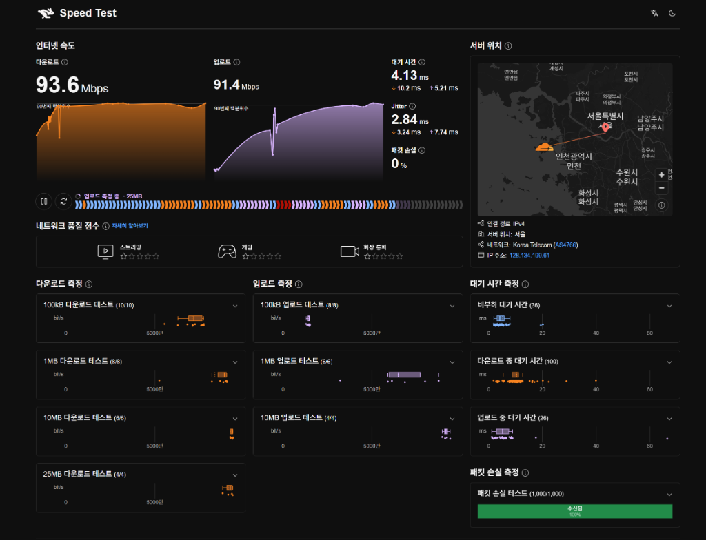
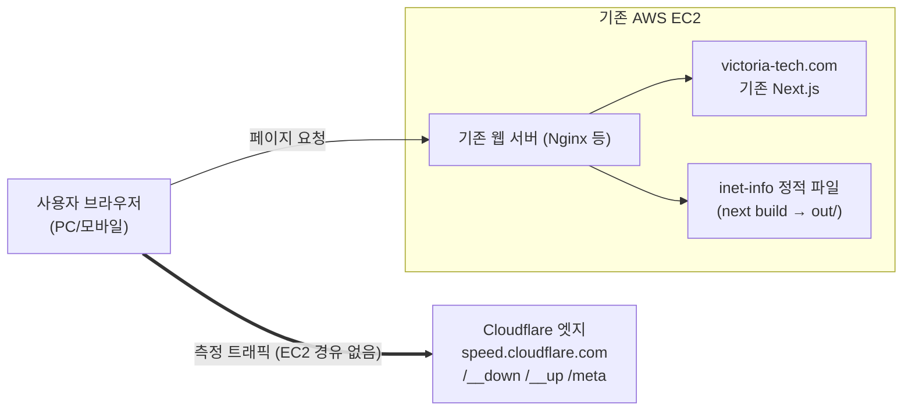
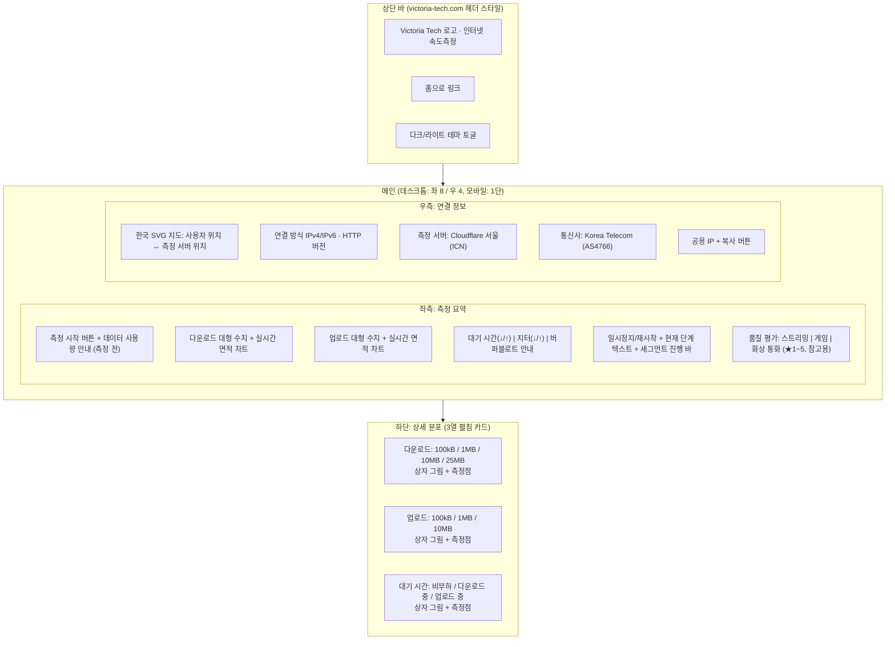

# 인터넷 속도 및 공용 IP 진단 서비스 기획안 (`inet-info`) — v3

> **문서 목적**: `victoria-tech.com`의 [인터넷 속도측정] 메뉴로 제공할 웹 기반(데스크톱·모바일) 인터넷 품질 진단 서비스의 기획 및 구성안입니다.
>
> **v3 원칙**
> 1. 측정은 Cloudflare 공개 라이브러리 [`@cloudflare/speedtest`](https://github.com/cloudflare/speedtest)(MIT)와 `speed.cloudflare.com` 엔드포인트를 그대로 사용합니다. 자체 측정 엔진·측정 서버는 만들지 않습니다.
> 2. **추가 비용 0원**: 유료 API, 유료 지도 타일, Cloudflare 계정·키가 필요한 기능은 쓰지 않습니다. 기존 EC2 외에 새 인프라를 만들지 않습니다.

---

## 0. 레퍼런스

- 참고 서비스: <https://speed.cloudflare.com/ko-kr>
- 참고 화면: [assets/reference-cloudflare-speedtest.png](./assets/reference-cloudflare-speedtest.png)



레퍼런스는 **정보 구조**만 참고합니다. 색상·글꼴·로고·헤더는 `victoria-tech.com`에 맞추고, Cloudflare 화면을 그대로 복제하지 않습니다.

---

## 1. 목표와 범위

### 목표
1. **신뢰할 수 있는 측정**: 크기별 다중 샘플, 90번째 백분위수, 부하 중 대기 시간, 지터를 Cloudflare 라이브러리로 측정합니다.
2. **풍부한 시각화**: 실시간 속도 차트, 크기별 상자 그림 + 측정점, 진행 바, 활용 분야별 품질 평가, 연결 정보를 한 화면에 보여줍니다.
3. **비용 0원·운영 부담 최소**: 서버 코드가 없는 **정적 사이트**로 빌드해 기존 EC2의 웹 서버가 파일만 제공합니다. 측정 트래픽은 사용자 ↔ Cloudflare 사이에서만 오갑니다.
4. **홈페이지와 일체감**: `victoria-tech.com`과 같은 Next.js, 같은 브랜드 스타일을 사용합니다.

### 비용 항목 점검
| 항목 | 비용 | 근거 |
| :--- | :--- | :--- |
| `speed.cloudflare.com` 측정·메타 정보 | 0원 | 계정·키 없는 공개 엔드포인트 |
| `@cloudflare/speedtest` | 0원 | MIT 라이선스 |
| EC2 | 추가 0원 | 정적 파일 수백 KB 제공만 함. 측정 트래픽은 EC2를 지나지 않음 |
| 지도 | 0원 | 타일 서비스 대신 SVG 지도 |
| 글꼴 | 0원 | 홈페이지 글꼴 또는 무료 글꼴을 직접 호스팅 |
| 인증서 | 0원 | 기존 인증서 또는 Let's Encrypt |

### 범위에서 제외
- **패킷 손실 측정**: 브라우저에서 정확하게 재려면 Cloudflare TURN(유료, GB당 $0.05, 계정·키 필요)이 필요하므로 제외합니다. HTTP 방식 대체 측정은 TCP 재전송 때문에 의미가 없어 만들지 않습니다.
- 자체 측정 서버, 자체 측정 엔진, 서버 API, 측정 결과 서버 저장
- 유료 IP 조회 API, 지도 타일 서비스

> **결과의 의미**: 측정값은 "사용자 ↔ 가장 가까운 Cloudflare 엣지(한국은 대개 서울 ICN)" 구간의 품질입니다. 화면에 "Cloudflare 네트워크 기준 측정 · Powered by Cloudflare"를 표기합니다.

---

## 2. 측정 엔진: `@cloudflare/speedtest`

- 버전: `1.15.x` (2026-10 기준 최신 1.15.0), MIT, TypeScript 타입 포함
- 브라우저 전용이므로 클라이언트 컴포넌트에서 동적 import로 불러옵니다.
- 설정: `autoStart: false`, TURN 관련 설정은 지정하지 않음 (패킷 손실 측정 없음)

### 2.1 측정 순서 (기본값 대신 직접 지정)
기본 순서에는 100MB·250MB 다운로드가 포함되어 모바일 데이터 소모가 큽니다. 레퍼런스 화면과 같은 단계로 줄입니다.

```ts
measurements: [
  { type: 'latency', numPackets: 1 },
  { type: 'download', bytes: 1e5, count: 1, bypassMinDuration: true },
  { type: 'latency', numPackets: 20 },
  { type: 'download', bytes: 1e5, count: 9 },
  { type: 'download', bytes: 1e6, count: 8 },
  { type: 'upload',   bytes: 1e5, count: 8 },
  { type: 'upload',   bytes: 1e6, count: 6 },
  { type: 'download', bytes: 1e7, count: 6 },
  { type: 'upload',   bytes: 1e7, count: 4 },
  { type: 'download', bytes: 2.5e7, count: 4 },
]
```

- **단계 건너뛰기**: `bandwidthFinishRequestDuration: 1000`(기본값). 한 단계의 요청이 1초 이상 걸리면 더 큰 단계는 건너뜁니다.
- **저속 회선 보호**: `bandwidthAbortRequestDuration`(예: 8000ms)으로 너무 오래 걸리는 요청을 중단합니다. 값은 구현 후 실측으로 조정합니다.
- **데이터 사용량**: 최대 다운로드 약 169MB + 업로드 약 47MB.

### 2.2 결과 사용
| 화면 요소 | 라이브러리 API |
| :--- | :--- |
| 다운로드/업로드 대표 속도 | `getDownloadBandwidth()`, `getUploadBandwidth()` (90번째 백분위수) |
| 실시간 속도 차트, 크기별 상자 그림 | `getDownloadBandwidthPoints()`, `getUploadBandwidthPoints()` (요청별 `bytes`, `bps`, `duration`, `measTime`) |
| 대기 시간 (비부하 / ↓ / ↑) | `getUnloadedLatency()`, `getDownLoadedLatency()`, `getUpLoadedLatency()` 및 각 `...Points()` |
| 지터 (비부하 / ↓ / ↑) | 지터 getter들 |
| 진행·제어 | `onRunningChange`, `onResultsChange`, `onFinish`, `onError`, `play()`, `pause()`, `restart()` |

> 실시간 차트는 "요청 1건 = 점 1개" 단위로 갱신됩니다(다운로드 최대 약 28개 점). 매끄러운 곡선은 점 사이 보간으로 그립니다.

### 2.3 활용 분야별 품질 평가 (자체 규칙)
라이브러리의 `getScores()`(AIM)는 패킷 손실 측정이 없으면 점수를 실제보다 낮게 계산하므로 사용하지 않습니다. 대신 측정된 값만으로 간단한 등급 규칙을 둡니다. 측정 엔진이 아니라 결과 해석 규칙이며, `lib/quality.ts` 한 파일로 관리합니다.

| 분야 | 사용 지표 | ★★★★★ 기준 (초안) |
| :--- | :--- | :--- |
| 스트리밍 | 다운로드, 다운로드 중 대기 시간 | 다운로드 ≥ 25 Mbps, 다운로드 중 대기 시간 < 100 ms |
| 온라인 게임 | 비부하·부하 대기 시간, 지터 | 대기 시간 < 25 ms, 부하 대기 시간 < 50 ms, 지터 < 5 ms |
| 화상 통화 | 다운로드·업로드, 부하 대기 시간, 지터 | 다운/업 ≥ 10 Mbps, 부하 대기 시간 < 100 ms, 지터 < 15 ms |

- 각 지표별 구간 표를 만들어 별 1~5개로 환산하고, 분야별로 가장 낮은 지표의 별 수를 최종 점수로 씁니다.
- 화면에 "패킷 손실은 측정하지 않으며, 평가는 참고용입니다"를 표기합니다.
- 기준값은 구현 단계에서 공개 자료(넷플릭스·줌 등 권장 속도)를 참고해 확정합니다.

### 2.4 버퍼블로트 안내
부하 중 대기 시간이 비부하 대비 크게 오르면(예: +100ms 이상 또는 3배 이상) "버퍼블로트 의심 — 공유기 혼잡 가능성" 안내를 표시합니다. 기준은 구현 시 확정합니다.

---

## 3. 연결 정보 (공용 IP · 통신사 · 위치)

Cloudflare 응답만 사용합니다. (2026-10-27 직접 확인)

| 출처 | 내용 | 비고 |
| :--- | :--- | :--- |
| `GET https://speed.cloudflare.com/meta` | `clientIp`, `asn`, `asOrganization`(예: Korea Telecom), `city`, `latitude/longitude`, `colo`(측정 서버 위치·좌표), `httpProtocol` | CORS 허용. **공식 문서에 없는 엔드포인트**이며 Referer 헤더가 없으면 403 |
| `GET https://speed.cloudflare.com/cdn-cgi/trace` | `ip`, `colo`(예: ICN), `loc`(국가), `http` | 폴백용. 통신사명·좌표 없음 |

- 폴백 시 통신사는 `AS번호`만, 지도는 측정 서버 위치만 표시합니다.
- IPv4/IPv6 여부는 IP 형식으로 판별합니다.
- IP는 화면 표시에만 쓰고 어디에도 저장·전송하지 않습니다.

---

## 4. 시스템 구성



### 4.1 빌드·배포: Next.js 정적 내보내기
- `next.config.ts`에 `output: 'export'`를 지정해 HTML/JS/CSS 정적 파일(`out/`)로 빌드합니다.
- 서버 코드가 없으므로 **Node 프로세스·포트·PM2가 필요 없고**, 기존 웹 서버가 폴더만 제공하면 됩니다.
- 배포: 로컬 또는 CI에서 `next build` → `out/`을 EC2의 지정 폴더로 복사 (`scp`/`rsync`).

### 4.2 연결 주소 (둘 중 선택)
| 방식 | 주소 | 필요한 작업 |
| :--- | :--- | :--- |
| **A. 하위 경로 (권장)** | `https://victoria-tech.com/speed` | 기존 서버 블록에 `location /speed/` 추가, `basePath: '/speed'` 빌드. DNS·인증서 추가 없음 |
| B. 서브도메인 | `https://speed.victoria-tech.com` | DNS 레코드 + 인증서(Let's Encrypt) + 서버 블록 추가 |

정적 파일만 제공하므로 하위 경로 방식의 단점(측정 API 경로 충돌, 버퍼링 설정)이 없어져 A를 권장합니다. 단, 기존 Next.js가 `/speed` 경로를 이미 쓰고 있지 않은지 확인이 필요합니다.

방식 A Nginx 예시:
```nginx
location /speed/ {
    alias /var/www/inet-info/out/;
    try_files $uri $uri.html $uri/index.html =404;
    add_header Cache-Control "no-cache";
}
location /speed/_next/static/ {
    alias /var/www/inet-info/out/_next/static/;
    add_header Cache-Control "public, max-age=31536000, immutable";
}
```
- CSP를 쓰는 경우 `connect-src`에 `https://speed.cloudflare.com` 허용
- `Referrer-Policy`는 `no-referrer`로 두지 않음 (`/meta` 403 방지)
- 기존 웹 서버 종류와 설정 위치는 배포 단계에서 확인

### 4.3 홈페이지 연동
- 기존 홈페이지 메뉴에 `<a href="/speed">인터넷 속도측정</a>` 한 줄 추가 (홈페이지 저장소에서 직접 작업)
- 속도측정 페이지 헤더에 Victoria Tech 로고와 "홈으로" 링크 배치

---

## 5. UI/UX 설계



### 5.1 시각 디자인
- 색상·글꼴은 `victoria-tech.com`을 확인해 맞춥니다. 다운로드·업로드·대기 시간·경고 색을 구분해 CSS 변수로 다크/라이트 두 벌을 정의합니다.
- 상자 그림 카드를 펼치면 최소·최대·평균·중앙값·90번째 백분위수 표를 보여줍니다.

### 5.2 반응형
- 1024px 이하: 좌우 패널 상하 배치. 768px 이하: 하단 카드 1열.
- 모바일 첫 화면에 다운로드·업로드, 대기 시간, 공용 IP가 보이도록 `clamp()`로 글자 크기 조정.

### 5.3 시작 방식과 데이터 안내
- 자동 시작하지 않고 **[측정 시작] 버튼**을 둡니다. 버튼 아래에 "1회 측정에 최대 약 220MB의 데이터를 사용합니다" 표시.
- 연결 정보는 측정 전에도 바로 조회해 보여줍니다.
- 측정 실패(Cloudflare 응답 오류, 네트워크 차단) 시 안내 문구와 다시 시도 버튼을 표시합니다.

---

## 6. 기술 스택

| 영역 | 선택 | 이유 |
| :--- | :--- | :--- |
| 프레임워크 | **Next.js (App Router) + TypeScript**, `output: 'export'` | 홈페이지와 같은 기술, 서버 불필요 |
| 측정 엔진 | **`@cloudflare/speedtest` 1.15.x** | 검증된 알고리즘, 무료 |
| 스타일 | 홈페이지와 같은 방식 (확인 후 결정, 기본안: CSS Modules + CSS 변수) | 브랜드 일관성 |
| 차트 | **직접 만든 SVG React 컴포넌트** | 데이터가 수십 개 점이라 라이브러리 불필요 |
| 지도 | **한국 SVG 지도 + 좌표 투영** | 무료, 외부 요청 없음 |
| 배포 | 정적 파일을 기존 EC2 웹 서버 폴더로 복사 | 프로세스 관리 불필요 |

**삭제 대상**: 현재 폴더의 임시 `package.json`(`cool-tesla-speedtest`, express/cors), `package-lock.json`, `node_modules`. 구현 시작 시 Next.js 프로젝트로 새로 만듭니다.

**홈페이지에서 확인할 것**: Next.js 버전과 스타일 방식(홈페이지의 `package.json`), 색상·글꼴·로고, `/speed` 경로 사용 여부, EC2 웹 서버 종류.

---

## 7. 디렉터리 구조안

```text
C:\devel\inet-info\
├── PLAN.md
├── assets/reference-cloudflare-speedtest.png
├── package.json
├── next.config.ts                # output: 'export', basePath: '/speed'
├── public/                       # 로고, 글꼴
└── src/
    ├── app/
    │   ├── layout.tsx            # 헤더(로고, 홈 링크, 테마 토글)
    │   ├── page.tsx              # 대시보드 껍데기
    │   └── globals.css           # 색상 변수, 다크/라이트 테마
    ├── components/
    │   ├── SpeedDashboard.tsx    # 'use client' — 측정 상태 관리, 라이브러리 연결
    │   ├── BandwidthChart.tsx    # 실시간 면적 차트 (SVG)
    │   ├── BoxPlot.tsx           # 상자 그림 + 측정점 (SVG)
    │   ├── MetricSummary.tsx     # 대기 시간 / 지터 / 버퍼블로트
    │   ├── ProgressBar.tsx       # 단계 진행 바
    │   ├── QualityRatings.tsx    # 분야별 별점
    │   ├── ConnectionPanel.tsx   # 지도 + IP/통신사/서버 정보
    │   └── KoreaMap.tsx
    └── lib/
        ├── speedtest.ts          # 라이브러리 설정(측정 순서)과 결과 → 화면 데이터 변환
        ├── connection-info.ts    # /meta 조회 + /cdn-cgi/trace 폴백
        ├── quality.ts            # 품질 평가 규칙 (§2.3)
        └── stats.ts              # 사분위수 등 상자 그림용 통계
```

---

## 8. 단계별 로드맵 (모두 비용 0원)

- **Phase 1 (MVP)**
  - Next.js 정적 프로젝트 생성, 라이브러리 연동, 측정 시작/일시정지/재시작
  - 다운로드·업로드 수치와 실시간 차트, 대기 시간·지터, 진행 바
  - 연결 정보 패널(`/meta` + 폴백), 한국 SVG 지도
  - 크기별 상자 그림 상세 카드, 다크/라이트, 반응형
- **Phase 2**
  - 품질 평가 별점, 버퍼블로트 안내
  - EC2 배포, `victoria-tech.com/speed` 연결, 홈페이지 메뉴 링크
- **Phase 3 (편의 기능, 모두 브라우저 안에서 처리)**
  - 측정 기록 `localStorage` 저장 및 이전 결과 비교
  - 결과 요약 이미지(PNG) 저장 (Canvas로 브라우저에서 생성)

---

## 9. 위험 요소와 대응

| 위험 | 대응 |
| :--- | :--- |
| Cloudflare가 외부 사이트의 `speed.cloudflare.com` 사용을 제한하거나 엔드포인트를 변경 | 공식 SLA가 없는 무료 서비스임을 전제로 함. 오류 시 안내 문구 표시. 장기 대안은 M-Lab NDT7(무료, 단 측정 데이터 공개 동의 필요) 또는 자체 서버(비용 발생) |
| `/meta`가 비공식이라 예고 없이 막힘 | `/cdn-cgi/trace` 폴백 (IP·측정 서버 위치는 유지) |
| 패킷 손실 미측정으로 품질 평가 정확도 저하 | 자체 규칙(§2.3)으로 평가하고 "참고용" 표기 |
| 모바일 데이터 과다 사용 | 자동 시작 금지, 사용량 안내, 25MB 상한 |
| 레퍼런스 화면 복제로 인한 디자인·상표 문제 | 홈페이지 브랜드 스타일 적용, "Powered by Cloudflare" 표기 |
